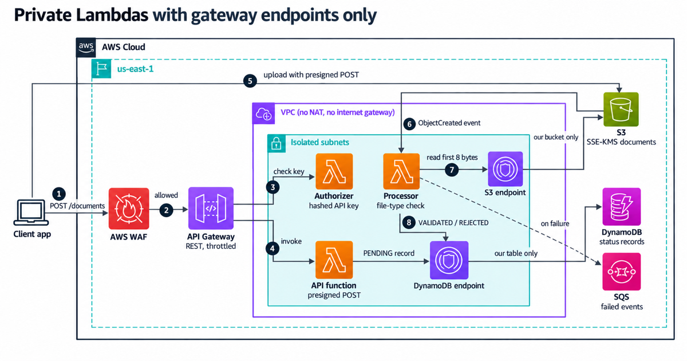

# Private Lambda document intake

A small AWS stack for taking in sensitive uploads (KYC files, signed contracts) where the Lambda functions have no route to the internet. They talk to Amazon S3 and Amazon DynamoDB through gateway endpoints, which cost nothing, and the endpoint policies only let them reach this stack's bucket and table.

There's no NAT gateway. Two of those would cost about $73 a month in us-east-1 before you process a single file.



## How a document moves through it

1. The client calls `POST /documents` with its API key. AWS WAF and stage throttling sit in front.
2. A Lambda authorizer hashes the key with SHA-256 and looks it up in DynamoDB. API Gateway caches the answer for 5 minutes.
3. The API function writes a `PENDING` record and returns a presigned S3 POST. The form expires after 5 minutes, and it only allows one object key, one content type and files up to 10 MB.
4. The client uploads the file straight to S3. Lambda never handles the bytes.
5. S3 invokes the processor function. It reads the first 8 bytes of the object, checks the real file type (PDF, PNG or JPEG), and marks the record `VALIDATED` or `REJECTED`.
6. The client polls `GET /documents/{id}` for the status. A client asking for another client's document gets the same 404 as for a missing one.

If processing fails, Lambda retries twice, then sends the event to an SQS queue, and a CloudWatch alarm fires.

## What you need

- Node.js 20 or newer (CI uses 24)
- An AWS account and credentials for it
- The account bootstrapped for CDK: `npx cdk bootstrap`

## Deploy

```bash
npm ci
# Set the browser origin that may call the API. Never use "*".
npx cdk deploy -c allowedOrigin=https://your-portal.example.com
```

The stack prints `ApiUrl` and `TableName` when it finishes.

Add a client and save the key it prints. The table only keeps the hash, so you can't recover a lost key:

```bash
TABLE_NAME=<TableName> npx ts-node scripts/add-client.ts acme
```

Then run the smoke test. It requests an upload, sends a small PDF to S3 and waits for `VALIDATED`:

```bash
API_URL=<ApiUrl> API_KEY=<key> npx ts-node scripts/smoke-test.ts
```

To turn off WAF (at low volume it's $7 of the $9 monthly bill), deploy with `-c enableWaf=false`.

## Tests

`npm run check` runs everything CI runs:

| Suite | What it proves |
|---|---|
| `test/unit` | Each handler on its own: hashed key lookup, upload policy limits, 404 for other clients' documents, duplicate S3 events, retries on real errors |
| `test/flow` | The full path through the real handler code with in-memory S3 and DynamoDB: a PDF ends `VALIDATED`, a renamed zip ends `REJECTED`, oversized or wrong-type uploads get refused |
| `test/infra` | The synthesized template: no NAT or internet gateway, gateway endpoints with policies, Bucket Key, TLS-only buckets, table deletion protection, authorizer cache, throttling, log retention |
| `test/infra/bundle.test.ts` | Each bundled Lambda file loads. CDK leaves `@aws-sdk/*` out of bundles by default, and the Lambda runtime doesn't include `@aws-sdk/s3-presigned-post`, so this test stops a "Cannot find module" from reaching AWS |
| `cdk synth` | The cdk-nag AWS Solutions pack. The few findings that are there by design carry a written reason in the stack code |

## Cost

At 10,000 documents a month of about 1 MB each, the bill comes to about $8.70 in us-east-1. See [docs/cost.md](docs/cost.md) for the line items and the prices behind them.

## Where this design stops working

- Your functions need a third-party API or an AWS service with no gateway endpoint (Secrets Manager, SES, Bedrock). Each interface endpoint costs $0.01 an hour per AZ, about $14.60 a month for two AZs.
- You have no private resources and no rule about outbound traffic. Then skip the VPC. IAM, KMS and the bucket settings still do most of the work.
- Files run to hundreds of MB, or checks take minutes. Move to multipart uploads and AWS Step Functions.
- You need malware scanning. The byte check only confirms the file type. Turn on Amazon GuardDuty Malware Protection for S3 for that.

## Clean up

```bash
npx cdk destroy
```

The bucket, table and KMS key stay behind on purpose (`RETAIN`), because they hold customer documents. Delete them by hand once you're sure you don't need the data.

## More

- [docs/security.md](docs/security.md): the controls and the AWS Security Hub checks they map to
- [docs/runbook.md](docs/runbook.md): what to do when the failure alarm fires
- Earlier version without these changes: [aws-cdk-serverless-document-pipeline-private-lambdas](https://github.com/InfraTales/aws-cdk-serverless-document-pipeline-private-lambdas)

Licensed under MIT, so you can copy it into your own projects.
